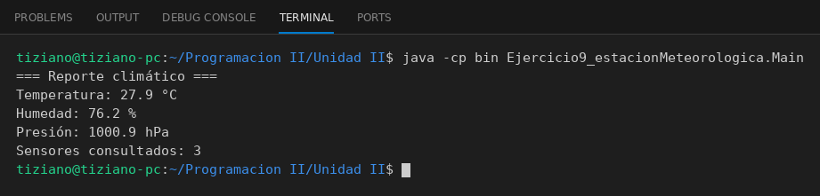

# EstacionMeteorologica

Programación II - Unidad 2 - Ejercicio 9

## Consigna
Una estación consulta a varios sensores y consolida un reporte climático.

## Lógica
- `Sensor`: tipo, unidad y rango; `obtenerLectura()` simula un valor aleatorio dentro del rango (semilla fija para resultados reproducibles).
- `EstacionMeteorologica`: mantiene una lista de sensores.
- `generarReporteClimatico()`: recorre la lista, le envía a cada sensor el mensaje de lectura e imprime los resultados.
- `Main`: tres sensores (temperatura, humedad y presión).

## Ejecución

